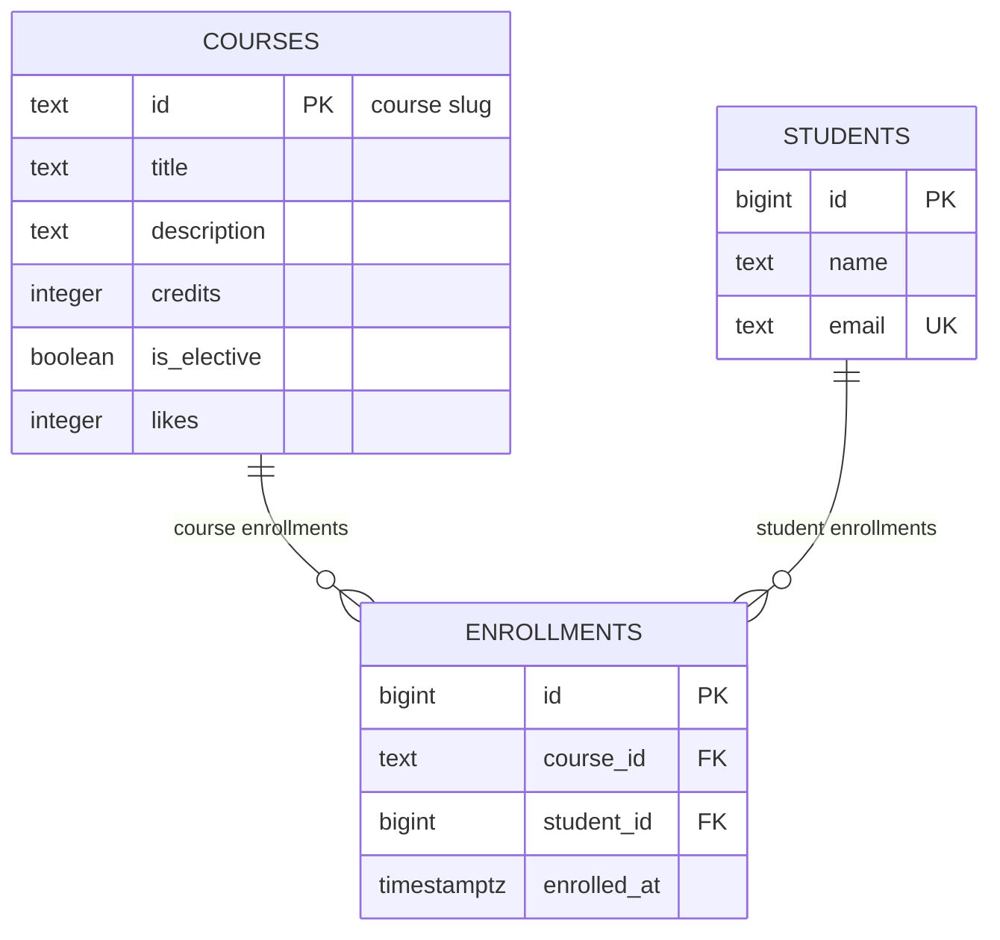

# course-catalog-db

PostgreSQL schema for the course catalog (Lab 6, “Advanced Web Technologies”).

## How to run

PostgreSQL 16 or newer and `psql` are required. Once, as a `postgres`
superuser, create the application role and main database:

```sql
CREATE ROLE catalog_app LOGIN PASSWORD 'change-me';
CREATE DATABASE course_catalog OWNER catalog_app;
```

From the project directory, apply the schema, seed data, and read-only/reverted
route examples:

```powershell
psql -h localhost -U catalog_app -d course_catalog -v ON_ERROR_STOP=1 -f schema.sql
psql -h localhost -U catalog_app -d course_catalog -v ON_ERROR_STOP=1 -f seed.sql
psql -h localhost -U catalog_app -d course_catalog -v ON_ERROR_STOP=1 -f queries.sql
```

`schema.sql` drops and recreates the three tables, so it is for this lab's
throwaway database, not for production data. `seed.sql` is intended to run
after a fresh schema. The password above is only a teaching example; don't
commit real credentials.

## Schema



`courses` and `students` are independent parent tables. `enrollments` links
them, so courses and students form a many-to-many relationship through
enrollments; each individual enrollment references exactly one course and one
student.

## Design decisions

- Course slugs are readable, stable identifiers and are already used in API
  paths, so `courses.id` is `text`. Student IDs are system-generated numeric
  identifiers (`bigint`): they are compact and don't depend on a person's name
  or email. Slugs are convenient for external references but can be renamed
  only by changing references; generated IDs are less human-readable but
  stable and efficient for joins.
- Deleting a course with enrollments is restricted to prevent losing enrollment
  history accidentally. Deleting a student cascades to their enrollments
  because those rows have no meaning without that student.
- `timestamptz` stores an unambiguous instant and converts it for the session's
  time zone; `timestamp` alone does not identify a time zone. PostgreSQL's
  `text` avoids an arbitrary length limit: use `CHECK` when a domain-specific
  length rule exists (as it does for student names).

## Constraint violation log

The ten deliberate failures are listed below. Run the commands one at a time
with `\set VERBOSITY verbose`; the restriction-delete SQLSTATE is version
dependent.

| # | What we violate | SQLSTATE | Constraint | API response |
|---|-----------------|----------|------------|--------------|
| 1 | NULL in `courses.title` | `23502` | NOT NULL (column `title`; no named constraint) | 422; if Pydantic allowed a missing required title through, that is an application bug (500) |
| 2 | `courses.credits = 0` | `23514` | `courses_credits_check` | 422 |
| 3 | `courses.likes = -1` | `23514` | `courses_likes_check` | 500; application code, not the user, increments likes |
| 4 | one-letter student name | `23514` | `students_name_check` | 422 |
| 5 | duplicate student email | `23505` | `students_email_key` | 409 Conflict |
| 6 | duplicate course id | `23505` | `courses_pkey` | 409 Conflict |
| 7 | duplicate course/student enrollment | `23505` | `enrollments_course_id_student_id_key` | 409 Conflict |
| 8 | enrollment in nonexistent course | `23503` | `enrollments_course_id_fkey` | 404 Not Found |
| 9 | enrollment for nonexistent student | `23503` | `enrollments_student_id_fkey` | 404 Not Found |
| 10 | delete a course that has enrollments | `23001` (PostgreSQL 18); `23503` (16–17) | `enrollments_course_id_fkey` | 409 Conflict |
| 11 | delete a student with enrollments (cascade) | No error | `enrollments_student_id_fkey` (`ON DELETE CASCADE`) | Successful deletion; 6 enrollments become 3; after `ROLLBACK`, 6 again |

Pydantic validation and database constraints are intentionally duplicated.
The API can reject bad requests early and return a useful 422, but other clients,
scripts, or future services may write directly to PostgreSQL. The database is
the shared final integrity boundary and protects data regardless of which
application performed the write.

## Self-review against the checklist

| What to check | Result |
|---------------|--------|
| Keys | Yes — all three tables have primary keys; both relationships have foreign keys from `enrollments`. |
| Types | Yes — slug is `text`, generated identifiers are `bigint`, credits/likes are `integer`, and enrollment time is `timestamptz`. |
| Required values | Yes — all columns are `NOT NULL`; elective, likes, and enrollment time have defaults where appropriate. |
| Constraints | Yes — credit and like bounds, name length, unique email, and unique enrollment pair are enforced in the database. |
| Deletion | Yes — course deletion is `RESTRICT`; student deletion cascades to dependent enrollments. |
| Normalization | Yes — student and course facts are stored once; enrollment stores foreign keys rather than copied names/titles. |
| Indexes and names | Yes — primary/unique constraints provide their indexes; the enrollment student foreign key has an explicit index; names use snake_case. |
