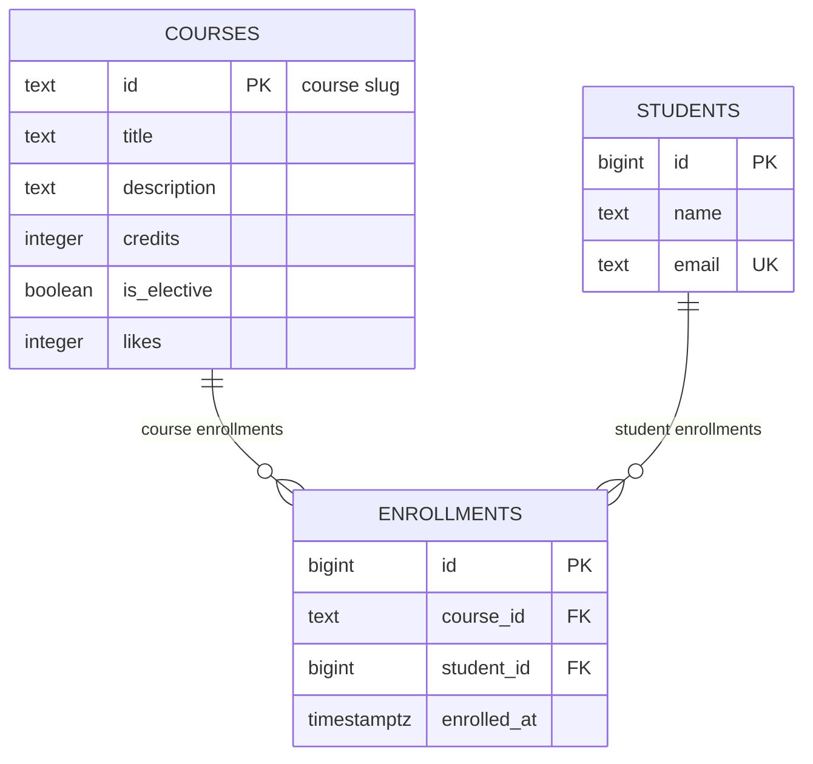

# course-catalog-db

PostgreSQL schema for the course catalog (Lab 6, “Advanced Web Technologies”).

## How to run

PostgreSQL 16 or newer and `psql` are required. Once, as a `postgres`
superuser, create the application role and main database:

```sql
CREATE ROLE catalog_app LOGIN PASSWORD 'change-me';
CREATE DATABASE course_catalog OWNER catalog_app;
CREATE DATABASE idx_demo OWNER catalog_app;
```

From the project directory, apply the schema, seed data, and read-only/reverted
route examples:

```powershell
psql -h localhost -U catalog_app -d course_catalog -v ON_ERROR_STOP=1 -f schema.sql
psql -h localhost -U catalog_app -d course_catalog -v ON_ERROR_STOP=1 -f seed.sql
psql -h localhost -U catalog_app -d course_catalog -v ON_ERROR_STOP=1 -f queries.sql
```

`schema.sql` drops and recreates the three tables, so it is for this lab's
throwaway database, not for production data. `seed.sql` is intended to run
after a fresh schema. The password above is only a teaching example; don't
commit real credentials.

## Schema



`courses` and `students` are independent parent tables. `enrollments` links
them, so courses and students form a many-to-many relationship through
enrollments; each individual enrollment references exactly one course and one
student.

## Design decisions

- Course slugs are readable, stable identifiers and are already used in API
  paths, so `courses.id` is `text`. Student IDs are system-generated numeric
  identifiers (`bigint`): they are compact and don't depend on a person's name
  or email. Slugs are convenient for external references but can be renamed
  only by changing references; generated IDs are less human-readable but
  stable and efficient for joins.
- Deleting a course with enrollments is restricted to prevent losing enrollment
  history accidentally. Deleting a student cascades to their enrollments
  because those rows have no meaning without that student.
- `timestamptz` stores an unambiguous instant and converts it for the session's
  time zone; `timestamp` alone does not identify a time zone. PostgreSQL's
  `text` avoids an arbitrary length limit: use `CHECK` when a domain-specific
  length rule exists (as it does for student names).

## Constraint violation log

The ten deliberate failures are listed below. Run the commands one at a time
with `\set VERBOSITY verbose`; the restriction-delete SQLSTATE is version
dependent.

Run each statement separately after a fresh `schema.sql` and `seed.sql`, so
each violation is isolated and the existing rows remain intact:

```sql
\set VERBOSITY verbose
INSERT INTO courses (id, title, description, credits)
VALUES ('x-test', NULL, 'Test', 3);
INSERT INTO courses (id, title, description, credits)
VALUES ('x-test', 'Test', 'Test', 0);
UPDATE courses SET likes = -1 WHERE id = 'api-design';
INSERT INTO students (name, email) VALUES ('A', 'a@example.com');
INSERT INTO students (name, email)
VALUES ('Dup Student', 'aigerim@example.com');
INSERT INTO courses (id, title, description, credits)
VALUES ('api-design', 'x', 'y', 1);
INSERT INTO enrollments (course_id, student_id)
VALUES ('modern-frontend', 1);
INSERT INTO enrollments (course_id, student_id)
VALUES ('no-such-course', 1);
INSERT INTO enrollments (course_id, student_id)
VALUES ('web-security', 999);
DELETE FROM courses WHERE id = 'modern-frontend';
```

| # | What we violate | SQLSTATE | Constraint | API response |
|---|-----------------|----------|------------|--------------|
| 1 | NULL in `courses.title` | `23502` | NOT NULL (column `title`; no named constraint) | 422; if Pydantic allowed a missing required title through, that is an application bug (500) |
| 2 | `courses.credits = 0` | `23514` | `courses_credits_check` | 422 |
| 3 | `courses.likes = -1` | `23514` | `courses_likes_check` | 500; application code, not the user, increments likes |
| 4 | one-letter student name | `23514` | `students_name_check` | 422 |
| 5 | duplicate student email | `23505` | `students_email_key` | 409 Conflict |
| 6 | duplicate course id | `23505` | `courses_pkey` | 409 Conflict |
| 7 | duplicate course/student enrollment | `23505` | `enrollments_course_id_student_id_key` | 409 Conflict |
| 8 | enrollment in nonexistent course | `23503` | `enrollments_course_id_fkey` | 404 Not Found |
| 9 | enrollment for nonexistent student | `23503` | `enrollments_student_id_fkey` | 404 Not Found |
| 10 | delete a course that has enrollments | `23001` (PostgreSQL 18); `23503` (16–17) | `enrollments_course_id_fkey` | 409 Conflict |
| 11 | delete a student with enrollments (cascade) | No error | `enrollments_student_id_fkey` (`ON DELETE CASCADE`) | Successful deletion; 6 enrollments become 3; after `ROLLBACK`, 6 again |

For row 11, run `BEGIN;`, count enrollments (6), delete Daniyar with
`DELETE FROM students WHERE email = 'daniyar@example.com';`, then count again
(3) and `ROLLBACK;`; the final count is 6. The violation commands and their
SQLSTATEs above are the expected results from the handout, not local psql
output; this workspace has no PostgreSQL server available to execute them.

Pydantic validation and database constraints are intentionally duplicated.
The API can reject bad requests early and return a useful 422, but other clients,
scripts, or future services may write directly to PostgreSQL. The database is
the shared final integrity boundary and protects data regardless of which
application performed the write.

## Index: EXPLAIN before and after

The experiment dataset is generated by [`experiments/idx_data.sql`](./experiments/idx_data.sql):
500 courses, 20,000 students, and 50,000 enrollments. Use a throwaway database,
not `course_catalog`. For an exact before/after comparison, initially remove
the index created by `schema.sql`:

```powershell
psql -h localhost -U catalog_app -d idx_demo -v ON_ERROR_STOP=1 -f schema.sql
psql -h localhost -U catalog_app -d idx_demo -v ON_ERROR_STOP=1 -f experiments/idx_data.sql
psql -h localhost -U catalog_app -d idx_demo -v ON_ERROR_STOP=1 -c "DROP INDEX enrollments_student_id_idx"
psql -h localhost -U catalog_app -d idx_demo -v ON_ERROR_STOP=1 -c "EXPLAIN ANALYZE SELECT * FROM enrollments WHERE student_id = 777"
psql -h localhost -U catalog_app -d idx_demo -v ON_ERROR_STOP=1 -c "CREATE INDEX enrollments_student_id_idx ON enrollments (student_id)"
psql -h localhost -U catalog_app -d idx_demo -v ON_ERROR_STOP=1 -c "EXPLAIN ANALYZE SELECT * FROM enrollments WHERE student_id = 777"
```

The following plans show the expected access methods; costs and estimates vary
by server version and machine. These representative cost figures are from the
lab handout. **This workspace had no running PostgreSQL server or `psql`, so
the commands and execution times have not been measured here.** Capture the
`Execution Time` values from both local `EXPLAIN ANALYZE` outputs to complete
the timing comparison.

Before the index (expected `Seq Scan`):

```text
Seq Scan on enrollments  (cost=0.00..1042.00 rows=3 width=34)
  Filter: (student_id = 777)
  Rows Removed by Filter: 49997
```

After the index (expected `Bitmap Heap Scan` with a `Bitmap Index Scan`):

```text
Bitmap Heap Scan on enrollments  (cost=4.31..15.59 rows=3 width=34)
  Recheck Cond: (student_id = 777)
  ->  Bitmap Index Scan on enrollments_student_id_idx  (cost=0.00..4.31 rows=3 width=0)
        Index Cond: (student_id = 777)
```

| State | Expected plan | `Execution Time` |
|-------|---------------|------------------|
| Before index | `Seq Scan`; filter on `student_id` | Not measured in this environment |
| After index | `Bitmap Index Scan` + `Bitmap Heap Scan` | Not measured in this environment |

Answers to the questions:

1. PostgreSQL does not automatically create indexes on foreign-key columns.
   The unique enrollment index starts with `course_id`, so it does not help
   searches by its second column, `student_id`.
2. A sequential scan is cheaper on a six-row `courses` table: reading one tiny
   table can cost less than using an index and fetching the matching row.
3. The index accelerates retrieving one student's enrollments and locating
   dependent enrollment rows when a student is deleted with `ON DELETE CASCADE`.

## Transaction

The experiment enrolls a new student using two inserts: create the student,
then create an enrollment referencing that student. If the second statement
fails, PostgreSQL marks the transaction aborted (`!>` in the `psql` prompt);
further statements are rejected until `ROLLBACK`. Rolling back removes the
first insert as well, so no student is left without the intended enrollment.
Without an explicit transaction, the first insert would already be committed
and the failed second insert would leave partial data.

To reproduce the failure on the main database:

```sql
BEGIN;
INSERT INTO students (name, email)
VALUES ('Madina Ospanova', 'madina@example.com');
INSERT INTO enrollments (course_id, student_id)
SELECT 'no-such-course', id FROM students
WHERE email = 'madina@example.com';
-- Foreign-key error; psql reports that the transaction is aborted.
ROLLBACK;
SELECT count(*) FROM students WHERE email = 'madina@example.com';
-- 0 rows
```

For the successful two-window version, run the student insert and a valid
enrollment insert (`web-security`) in window A after `BEGIN`, but do not commit.
Window B, connected to the same database, sees `0` rows for
`madina@example.com`. After `COMMIT` in window A, rerun the query in window B:
it sees `1` row, and both the student and enrollment become visible together.
`SHOW default_transaction_isolation;` reports `read committed`, the default
isolation level; each statement sees rows committed before that statement
began.

The transaction tests above were documented from the lab's expected behavior,
not executed locally: this environment has no `psql` installation and its
Docker PostgreSQL daemon is not running.

## Self-review against the checklist

| What to check | Result |
|---------------|--------|
| Keys | Yes — all three tables have primary keys; both relationships have foreign keys from `enrollments`. |
| Types | Yes — slug is `text`, generated identifiers are `bigint`, credits/likes are `integer`, and enrollment time is `timestamptz`. |
| Required values | Yes — all columns are `NOT NULL`; elective, likes, and enrollment time have defaults where appropriate. |
| Constraints | Yes — credit and like bounds, name length, unique email, and unique enrollment pair are enforced in the database. |
| Deletion | Yes — course deletion is `RESTRICT`; student deletion cascades to dependent enrollments. |
| Normalization | Yes — student and course facts are stored once; enrollment stores foreign keys rather than copied names/titles. |
| Indexes and names | Yes — primary/unique constraints provide their indexes; the enrollment student foreign key has an explicit index; names use snake_case. |
